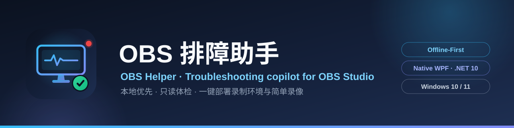
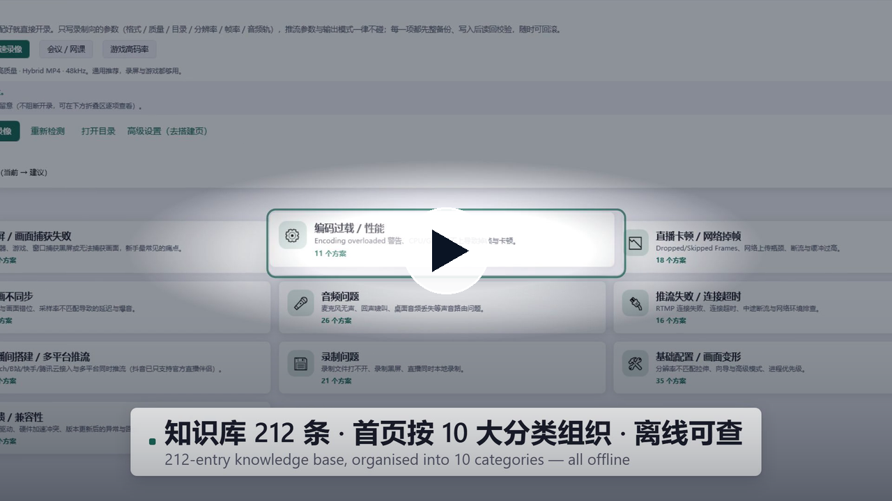
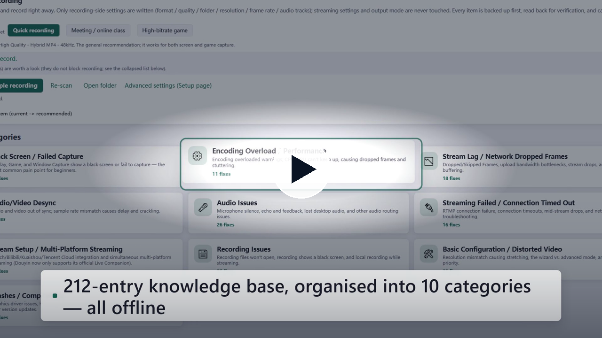

<div align="center">



# OBS Helper · OBS帮助助手

**Current release: V3.5.2** — trustworthy recording / streaming state: the desktop app and the phone page no longer keep showing “Recording / LIVE” after recording stops; the phone status pill distinguishes live from recording; batch status queries now use the correct obs-websocket protocol. See [RELEASE_NOTES_v3.5.2.md](RELEASE_NOTES_v3.5.2.md); the X series `X1031` / `X1031Y2` / `X1031Y3` is available too.

> **V / X series**: V releases use `V3.5.2`-style versions; X releases use `X` + `MMdd` date codes such as `X1031`, with `Y1`/`Y2`/`Y3` appended for a second release on the same day. Both share features and the data folder, but each channel only checks its own tags: V builds only `V*`, X builds only `X*`.

> **This is the developer-facing full documentation for the Windows native WPF version and it lives inside `NOBS/`**;
> the repository-root [`README.md`](../README.md) is the complete user-facing guide (features · usage · installation),
> while this document additionally keeps the quality baseline, per-release notes and code inventory. The maintained
> source code is [`OBS_Helper.Wpf/`](OBS_Helper.Wpf/) in this folder; the macOS shell and the old shared frontend are archived.

**The offline-first troubleshooting companion for [OBS Studio](https://obsproject.com/) — built for streamers who are just getting started.**

[](https://github.com/YYRMMAYO/OBS_Helper/actions/workflows/ci.yml)
[]()
[]()
[]()
[](https://github.com/YYRMMAYO/OBS_Helper/releases)
[](https://github.com/obsproject/obs-studio/releases)
[]()
[]()
[]()
[](../LICENSE)

**English** · [简体中文](README.md)

</div>

> **The default branch `master` is the stable channel**: fully regression-tested and verified before release —
> the right choice for everyday streaming and recording. The `dev` branch carries DEV test builds
> (`01`, `02`, `03`…, **no leading V**): further ahead, potentially unstable, and updated only from the dev Releases page.

> **What is it?** OBS Helper is a native **Windows (WPF)** desktop app that helps you get unstuck with OBS Studio — find a fix for that weird stutter, analyze your OBS logs, or control scenes, recording and streaming right from a hotkey or a tiny always-on-top window. The entire knowledge base, troubleshooting guide and log-analysis rules are **embedded in the app**: everything works with **zero internet connection**.
>
> This is the **native WPF rewrite** of the original Blazor + WebView2 version (source lives in [`OBS_Helper.Wpf/`](OBS_Helper.Wpf/)). The browser engine is gone, startup is instant, and it ships as a single self-contained folder.
>
> **Since V2.2 there's a built-in plugin directory**: 57 curated plugins with direct GitHub Releases downloads, a read-only scan of locally installed plugins (with multi-drive OBS install detection), and log-analysis links that jump straight to the suspect plugin. **Since V2.1, updates are incremental and knowledge bases update independently**: only changed files are downloaded, and both the issue database and the plugin catalog can be upgraded without waiting for a new release.
>
> **V2.9.6 renames the app to 「OBS帮助助手」** — the Chinese display name only; the English name stays **OBS Helper**. It also unifies the application icon with the repository mark (same monitor / waveform / record-dot / check design as `assets/icon.svg`) and redraws the 16 / 24 / 32 px frames for small sizes so the taskbar and tray icon stay readable. **Nothing about installing or upgrading changed**: same `AppId`, same `OBS_Helper.exe`, same `%LocalAppData%\OBS_Helper` data folder, same Release asset names — existing installs upgrade in place with their settings intact, and only brand-new installs use the new folder name. V2.9.5, the previous release, fixed a feedback route that could never work (GitHub has no user-to-user DMs) and made the security policy bilingual. See [RELEASE_NOTES_v2.9.6.md](RELEASE_NOTES_v2.9.6.md) (Chinese).
>
> **V2.9.4 adds simple recording.** V2.9.3 answered "what should the settings look like"; this release answers "click once and it is recording, and you know what is happening while it records". A card on the home page offers three presets — **Quick** (1080p60), **Meeting / lecture** (1080p30) and **Game, high bitrate** (1080p60 with automatic file splitting) — and one click runs the whole chain: pre-flight check → full backup → apply → *if OBS is not running, launch it and wait for obs-websocket* → start recording. While recording you see the elapsed time (from OBS's own timecode, so pauses are not counted) and an estimated time left; when you stop, the file is reported (with its size) and you can open the folder or remux it to MP4. Write scope is deliberately limited to recording-side keys (format / quality / audio tracks / splitting): **streaming settings, output mode, encoder family and bitrate are never touched**. There is also a new top-level **Help & feedback** page (report form, GitHub issues, offline QR code, plus a one-click snapshot of version / OS / OBS state / pre-flight result — no paths and no raw logs), and the repository gained a redrawn vector icon, cover and social preview plus the missing community files. See [RELEASE_NOTES_v2.9.4.md](RELEASE_NOTES_v2.9.4.md) (Chinese).
>
> **V2.9.3 translates the bundled offline content as well** — the knowledge base (**212 entries, ~57.7k Chinese characters**), the plugin catalog (57 entries), the scene templates (12 templates, 323 translatable leaves) and the troubleshooting guide all ship as parallel English assets (`problems.en-US.json`, …), and they follow the interface language instantly. The Chinese file names are deliberately **left unchanged**, because the GitHub-raw update URLs, the Release asset names and the caches already downloaded on users' machines all depend on them. A single entry point (`Localization/ContentAssets`) resolves content as *current-language external cache → current-language embedded → Chinese embedded*, and that last fallback **always writes a WARN** — a silent Chinese fallback is exactly the kind of failure this project has been burned by before. Both update channels (raw and Release assets) are now language-aware: the old asset matcher would happily match both the Chinese and the English file in the same Release, so users of each language could silently receive the other's file. This release also adds a **one-click recording-environment setup** (recording format / quality / folder / canvas resolution / frame rate / sample rate, all backed up first and one-click reversible, applied over obs-websocket when OBS is connected and via `basic.ini` with read-back verification when it is not), **in-app downloading of the official OBS installer** (progress, official-domain validation, then the normal installer wizard — never a silent install), two backup routes (Watt Toolkit for GitHub acceleration, the Microsoft Store listing), a **bug-report form with an offline-scannable QR code**, and a **Windows 7 SP1 compatible build** (dual-targeting `net6.0-windows` alongside `net10.0-windows`, shipped as `*_win7` installers/portables with the right `MinVersion`). See [RELEASE_NOTES_v2.9.3.md](https://github.com/YYRMMAYO/OBS_Helper/releases/tag/V2.9.3) (Chinese).
>
> **V2.9.2 adds Chinese / English switching at runtime** (Simplified Chinese is the default): the interface, tray menu and notifications, error messages, log-analysis rules and conclusions, every health-check verdict, diagnostic reports and exported content all ship in both languages, with **1670 string keys**. Switching reuses the same mechanism as themes — the string table is written into `Application.Resources` and XAML refers to it through `{DynamicResource Loc.*}` — so it takes effect **instantly, with no restart**; strings built in code are refreshed by re-running the current page's existing navigation lifecycle. The **installer now asks which language you want** (Simplified Chinese is preselected and system detection is off) and passes the choice to the app through `language.ini` as its first-run default; in-app choices always win, so reinstalling or upgrading never overrides them. See [RELEASE_NOTES_v2.9.2.md](RELEASE_NOTES_v2.9.2.md) (Chinese).
>
> **V2.9.1 fixes the knowledge-base raw channel** (both GitHub-raw URLs were missing the repository's leading `NOBS/` segment, so they had always returned 404 and every check silently fell back to the Release asset — a commit now really does reach every install, and non-2xx responses are logged), turns the **first-run tutorial into a guided tour that navigates the UI** for you, and adds **official OBS download entries** (obsproject.com / the official GitHub releases, plus a direct link to the current stable Windows installer resolved via the GitHub API — official hosts only, so fake "download sites" don't get a chance). See [RELEASE_NOTES_v2.9.1.md](RELEASE_NOTES_v2.9.1.md) (Chinese).
---

## Release channels: stable vs DEV

There are two channels for the same app — pick the one that matches how much "new" you want:

| Channel | Version style | What it is | Where updates come from |
| --- | --- | --- | --- |
| **Stable** | `V3.1.1` | **Stable first**: settled features, full regression and release verification — the right choice for everyday streaming / recording | The regular Releases page · the Lanzou mirror · in-app incremental updates |
| **DEV (test)** | `01`, `02`, `03` … (**no leading V**) | **Further ahead**: work in progress lands here first and **may include unstable features**, behaviour changes and known bugs | **Only** the **dev Releases page** |

- **Why DEV has its own channel**: DEV builds are numbered by an auto-incrementing **build number**, which is not comparable to the stable `Vmajor.minor.patch` scheme. A DEV build therefore **only recognises plain-number tags (`01`)**, and a stable build **only recognises `V3.1.1`-style tags** — even though both kinds of tag live in the same repository, neither channel mistakes the other for a newer version.
- **DEV builds are not packaged and do not use the Lanzou mirror yet**: the update prompt only points you at the dev Releases page (`/releases/tag/0X`). Incremental updates, the Lanzou mirror and installers keep serving stable users exactly as before.
- **Which one should you pick?** Use stable for day-to-day work; take DEV if you want early features and can live with the occasional broken build. Please report DEV issues through *Help & feedback* and put `DEV 0X` (e.g. `DEV 03`) in the description.

## V3.5.2 highlights

- **“Recording” stuck after stop**: events are authoritative; OBS’s brief `outputActive=true` right after the stop event no longer flips the UI back. A 3-second reconciliation covers missed events.
- **Phone refresh shows the truth**: the page reconciles before rendering; “LIVE”, “REC” and “LIVE · REC” are distinguished; the record timer reads `00:00:00` when idle.
- **Batch protocol fixed**: `RequestBatch` (op 8 / 9) with numeric execution types; output state and audio mute / volume refresh again.
- **Mini window**: remaining time is a whole number of minutes.

## V3.5.1 highlights

- **Detail icon fix**: the settings detail header and Feature Center cards now render outline geometry with `Stroke`; circles / boxes no longer become solid blobs.
- **Semantic icons**: language = globe, appearance = palette, background = tray, recording = camera, auto-switch = arrows, hotkeys = keyboard, AI = chip, guide = pulse, data = database, OBS config = archive, onboarding = compass, about = info circle (Tabler Icons, MIT).
- **Phone script editing fixed**: teleprompter window updates are marshalled to the UI thread, so saving from the phone immediately refreshes the desktop teleprompter.
- **Sponsorship**: Settings → About and Help & Feedback → About this tool add Alipay / WeChat codes, with an explicit note that sponsorship unlocks no special features.

## V3.5.0 highlights

- **Global background UI refactor**: the wallpaper layer now covers the whole window (navigation, top bar and pages). In image mode, navigation/top bar/cards use translucent surfaces; default/colour/high-contrast stay opaque. The previous UI is saved as tag `ui-baseline-v3.4.2`.
- **Mobile connection page**: hero area, equal-width segmented navigation, pairing card and device cards; no horizontal squeeze on narrow windows.
- **Feature Center**: a “what works right now” status strip (OBS / phone service / media server / teleprompter) before the module list.
- **Shared fixes**: GitHub accelerator guidance, merged installed-plugin sources, one-click media server, 10 VTuber templates, rebuilt mini window, phone teleprompter editing, bilingual guide rewrite and corrected icon semantics.
- **Verification**: 1,729 unit tests pass; both builds 0 errors; 2,649 resource references across 47 XAML files resolve.

## X1031Y3 highlights

- **Fixed all plugin / dependency one-click downloads failing**: GitHub release assets now 302 to `release-assets.githubusercontent.com`; the old allowlist rejected the final host. The new CDN is allowed in the plugin, dependency and sidecar allowlists, with diagnostics and regression tests.
- **Full Feature Center audit**: 17 items overclaim (phone microphone has no endpoint, "AI reply/director" are templates/rules, theme market is JSON import only, auto-archive needs a manual click, etc.). All are written into the Y3 guide, split into Y3 follow-up and Y4.
- **Shipped in this build**: one-click dependency UI (whisper / FFmpeg / rclone with auto-fill), whisper model download, phone camera QR / publish detection / firewall rule, Feature Center runtime setup + status chips, Q05 auto-archive, C10 / E06 persistence, MediaMTX WebRTC watch + OBS WHIP URL, and a local recording-file index.
- **Explicit boundaries**: LLM reply / partner, real AI director, online theme market, networked team collaboration, Twitch / YouTube viewer stats, and browser-as-camera are not wired. Guide §13 documents why, how to connect them yourself, and what is not claimed.

## X1031 highlights

- **Independent X channel**: X1031 only checks tags starting with `X`; V3.6.0-style tags are invisible to X users. The UI shows `X1031`, or `X1031Y2` / `X1031Y3` for same-day re-releases. Update checks compare the date first, then the Y revision.
- **Release notes in the update dialog**: X-series update prompts fetch and show this release's GitHub Release notes; a failed fetch does not affect updating.
- **New app icon**: black rounded plate with white `OBS`, `helper`, and an overlapping teal arc; window, taskbar, tray and installer use the same mark.
- **Plugin experience**: GitHub accelerator guidance (Watt Toolkit / Steam++) with a re-check button; the installed list merges “managed by this app” and “detected locally”, so plugins you added to OBS yourself are visible too.
- **Phone camera**: mediamtx pinned to v1.21.3 with SHA-256 and one-click install; the media server can start before OBS connects, and the source is added automatically afterwards.
- **VTuber templates**: expanded from 6 to 10 (karaoke, study, duo collab, hand camera); the chat template no longer overlaps the avatar.
- **Mini control**: save replay, scene switching, audio mute, teleprompter, studio mode and main-window entry.
- **Phone teleprompter editing**: edit and save the script from the phone, with the last 5 backups kept.
- **Guide rewrite**: a 5-minute setup section plus plugin acceleration, phone camera, VTuber and phone editing steps.

## V3.4.2 highlights

- **Feature Center without version labels**: the left navigation no longer says "V3.4.x NEW", and the Feature Center/home hero no longer carry version badges or split modules into "new this release / everyday". Capabilities are grouped by domain.
- **Settings rebuilt**: a left rail groups pages into Basics, Recording & automation, AI & diagnostics, Data & storage, and About & help; the right side shows one page at a time with a one-line guide. "Global hotkeys" and "Local data" are split out of the old combined cards.
- **Search**: filter settings by title, guide text or keywords; a no-results state keeps the search honest.
- **Toolbox reorganised**: 18 tools are grouped into Recording & files, Video checks, Audio checks, Network & streaming, Parameters & privacy, Conflicts & versions, and Help & feedback; group chips and the section directory stay in sync.
- **Fixes**: the "jump to section" list duplicated after a language switch (the builder never cleared its children); code-generated Feature Center/Settings text now refreshes on language change; duplicate `using` directives and a nullable warning were removed.
- **Verification**: all **1729 unit tests** pass; both builds (`net10.0-windows` / `net6.0-windows`) compile with 0 errors; all 2,633 resource references across 47 XAML files resolve.

## V3.4.1 highlights

- **Phone page repaired**: the i18n payload is embedded as `{ key: [zh, en] }`; the blank-page failure is gone and a regression test round-trips the injected JSON.
- **Refresh & reconnect**: the pairing token is persisted (`localStorage`, with `sessionStorage` fallback), so a reload reconnects; missing credentials show a clear "scan again" prompt instead of an empty shell.
- **Browser compatibility**: safe-area/sticky fallbacks, legacy DOM polyfills, and an ES5 boot watchdog that shows a readable message on old or broken browsers.
- **Phone UX**: light/dark/system themes (dark is not pure black), 17px typography, 360px-first layout, 44–52px touch targets, live preview via `blob:`, start/stop streaming, prompter nudge.
- **Reliability**: tray balloons no longer crash on empty text; StopRecord/StopStream treat "already stopped" (OBS 501) as success; mobile errors now distinguish offline / OBS rejection / execution failure.
- **Open-source dependency center** on the Plugins page: one-click official GitHub Releases and one-click local setup for FFmpeg, rclone, whisper.cpp and MediaMTX.

## V3.1.1 highlights

> A focused patch: the teleprompter finally has **manual up/down movement** through four independent routes —
> toolbar buttons, dragging the text, the mouse wheel and the keyboard — and the window itself can be nudged with
> `Ctrl + arrow keys`. Auto-scroll no longer ends on a blank screen. Data formats and the upgrade path are
> identical to V3.1.0, so incremental updates just work.

**Teleprompter: manual up/down movement (P0)**

- New toolbar buttons `⤒` (back to start), `▲` (one line up) and `▼` (one line down) — one click, **no keyboard focus needed**;
- **Drag the text**: hold and drag vertically in the body and the content follows your hand; auto-scroll pauses while dragging;
- **Keyboard**: `↑` / `↓` one line, `PgUp` / `PgDn` one screen, `Home` / `End`, space to pause/resume;
  clicking the body now activates the window so the keys work immediately (they were ignored right after opening before);
- **Wheel**: about 72 px per notch for fine adjustments;
- **Window position**: `Ctrl + ↑ / ↓ / ← / →` moves the window by 10 px, always clamped to the virtual screen;
- Position and size are saved automatically 600 ms after a drag or nudge (previously only on close);
- The whole top bar can be used to drag the window (previously only the tiny title label worked).

**Scroll end fixed (P1)**

- The old limit used `ScrollableHeight`, which included the 220 px bottom padding: once the last line left the
  viewport the window showed nothing but black;
- The end is now computed so that **the last line stops exactly at the reading guide**
  (`TeleprompterCore.ScrollEnd`), for both auto and manual scrolling;
- Trailing blank lines / spaces in the script are trimmed on save and load so an empty last line cannot eat the scroll range.

**Tests**

- 4 new unit tests: scroll end, drag offset, window-move clamping and script trailing blank lines;
- The full suite of 1508 unit tests passed three rounds in a row, with both builds (`net10.0-windows` / `net6.0-windows`) + the headless self-test + static checks all green.

## V3.1.0 highlights

> The theme of this release is **fewer clicks for everyday work**: wallpapers grew from "pick one image" into a
> managed library, one-click recording is now genuinely one click, and the release adds a teleprompter plus a batch
> of recording-day tools. The data-safety, accessibility, Win7-compatible build and zero-third-party-dependency
> baselines are unchanged.

**Personal wallpapers (P0)**

- Wallpaper library: multi-select import, locally owned copies, thumbnail picker, delete, SHA-256 de-duplication, survives restarts;
- Fit modes (fill / fit / center / tile), dimming 0–80% (default 15% light / 40% dark), optional blur;
- Slideshow from 30 seconds to 1 hour, random order with no repeat inside a round, paused while minimised or inactive;
- The old `bgImage` setting is migrated on first launch; missing / corrupt / unsupported files fall back to the default background with a visible note — never a crash, never silence;
- High-contrast mode forces wallpapers off; "reduce motion" skips the fade.

**Launch OBS and connect in one click (P0)**

- OBS not running: one explanation the first time (continue and remember / ask every time / I will open it myself), then one click from then on;
- OBS running but not connected: connects for you (single-flight, bounded timeout, cancellable, returns immediately if OBS exits);
- Once connected it applies the recording settings and starts recording; the legacy v4 protocol keeps "skip settings, record straight away";
- Every failure class (OBS not found / launch failed / port closed / handshake failed / password needed / wrong password / timeout / cancelled / OBS exited) offers at least one actionable way out;
- Staged progress with a "waiting N s" counter, plus an optional 0 / 3 / 5 / 10 second countdown before recording (0 = off, disabled by default).

**Teleprompter (P0)**

- Separate always-on-top window: borderless, draggable and resizable, auto-scroll, speed / font size / line height / opacity / side margins;
- Horizontal and vertical mirroring, click-through (close with `Ctrl+Alt+L`), 3-2-1 countdown, reading guide line;
- Script editor / paste / import `.txt` / `.md` with an auto-saved draft — fully local, no network;
- Hotkeys: `Ctrl+Alt+T` show / hide, `Ctrl+Alt+P` play / pause;
- Scene sync: write `## scene name` markers in the script; switching scenes only scrolls the teleprompter and **never switches OBS scenes by itself**;
- Capture exclusion: window and game capture never include the teleprompter; display capture tries `WDA_EXCLUDEFROMCAPTURE` on Windows 10 2004+, and where that is unavailable the docs say so and point at window capture or a second screen (**no "it can never be recorded" promise**).

**Also in this release**

- Recording filename templates with `{date}` `{time}` `{datetime}` `{scene}` `{profile}` `{resolution}` `{fps}` `{ext}`; illegal characters sanitised, collisions numbered, the original file kept if the rename fails;
- Tray alerts when the mic stays muted for more than 8 s, or below -55 dB for more than 10 s, while recording / streaming (alert only — your audio state is never changed for you);
- UI visual tokens 1.0 (spacing / radius / motion) that new pages reference;
- An easter egg: the KONAMI code unlocks a hidden "midnight teal" palette — local, silent, optional, and it respects "reduce motion".

> Two planned items did **not** ship in V3.1.0: the live-stream checklist (already covered by the pre-flight check)
> and the AI auto-streaming MVP, which moves to 3.2. See the release notes for the full "not delivered / known limits" list.

## Promo video

A 55-second look at what OBS Helper can do — Chinese and English versions, both with background music. Click a poster to watch in HD:

<div align="center">

[](https://github.com/YYRMMAYO/OBS_Helper/releases/download/V2.9.6/nobs-promo-zh.mp4)

▲ **Promo video · Chinese** (with BGM): pre-flight check · offline log analysis and three-way dropped-frame triage · one-click recording-environment setup · local plugin health check · global hotkeys and live monitoring — [Watch / download HD](https://github.com/YYRMMAYO/OBS_Helper/releases/download/V2.9.6/nobs-promo-zh.mp4) (1920×1080 · 30fps · 55s)

<br/><br/>

[](https://github.com/YYRMMAYO/OBS_Helper/releases/download/V2.9.6/nobs-promo-en.mp4)

▲ **Promo video · English** (with BGM): the same film with an English interface and subtitles — [Watch / download HD](https://github.com/YYRMMAYO/OBS_Helper/releases/download/V2.9.6/nobs-promo-en.mp4) (1920×1080 · 30fps · 55s)

</div>

## Highlights

| | |
|---|---|
| **Chinese / English, switched instantly** | The interface, tray, notifications, error messages, log rules and health-check verdicts all ship in both languages — **Simplified Chinese by default** — and switching under *Settings → Language* takes effect immediately, with no restart. The installer asks first and uses that answer as the first-run default. Bundled offline content (issue database, templates, plugin catalog, guide) is bilingual too, since V2.9.3; see [I18N_EN_CONTENT_PLAN](docs/I18N_EN_CONTENT_PLAN.md) |
| **208 fixes, fully offline** | A built-in knowledge base of **208 curated issues** (knowledge base v2.3, organised into 14 categories on the home screen) — symptoms, root causes, step-by-step fixes, tips and related questions. Steps are checkable and your progress is remembered. The **knowledge base updates independently** from the app. |
| **First-run tutorial (V2.9, guided since V2.9.1)** | A four-step tour on first launch — connect to OBS → where to look when something breaks → one-click health check → go live & decorate. Since V2.9.1 each step **switches the app to the page it is describing** (card tucked into the bottom-right corner, overlay kept light so the page stays readable) and offers extra jump buttons for the other pages it mentions. Replay it any time from *Settings → Onboarding* without restarting. |
| **Official OBS download entries (V2.9.1)** | For people who can't get hold of genuine OBS: the build page, the toolbox, the home welcome card, the first tutorial step and the troubleshooting guide all link to the **official site** (obsproject.com, Chinese page) and the **official GitHub releases**, plus a "download the current stable Windows installer" button whose direct link is resolved from the GitHub API. Every URL is forced to https and restricted to official hosts (`obsproject.com`, `cdn-fastly.obsproject.com`, `github.com/obsproject/obs-studio`) — a tampered API response makes the app fall back to the release page instead of opening a third-party site. |
| **Plugin square + local plugin health check** | **57 curated plugins** across 8 categories, fully re-audited in V2.9 (repository not archived, recently maintained, Windows build available) with a **maintenance status** shown on each card; a **read-only scan** of locally installed plugins locates the OBS install directory across all drives — registry (multi-view + HKCU + DisplayIcon fallback), per-drive standard layouts, Steam libraries and the OBS 32.x per-plugin roots (`%ProgramData%\obs-studio\plugins\<name>\bin\64bit`) — so non-C-drive and new-style installs are never missed. Log analysis can link a suspect module straight to its plugin card. |
| **Incremental updates** | Since V2.1 the in-app "incremental update" downloads only changed files (usually a few MB — the 3.1.1 delta is about **2.5 MB**); every file is SHA-256 verified, with automatic fallback to the full installer; installed versions auto-elevate, swap files and restart. |
| **Auto-cleanup of installers** | On startup the app scans temp / Downloads / Desktop folders and deletes old OBS_Helper installers & delta packages (newest kept per kind), only ever touching `OBS_Helper_*` files. |
| **Free AI diagnostics, zero setup** | No API key, no sign-up, no configuration. Two built-in free channels (Zhipu for mainland China, Pollinations worldwide), rate-limited **locally** to protect the free service, with automatic fallback to the offline engine. |
| **Remote-control your OBS** | Switch scenes, toggle sources, mute audio, start/stop recording, streaming and the virtual camera, schedule stops, and open your recording folder — from the console page, the system tray, a global hotkey, or a mini always-on-top window. |
| **Hotkeys for everything** | `Ctrl+Alt+R` record · `Ctrl+Alt+S` stream · `Ctrl+Alt+C` virtual camera · `Ctrl+Alt+V` save replay buffer · `Ctrl+Alt+K` recording marker · `Ctrl+Alt+M` mini window · `Ctrl+Alt+O` show/hide · `Ctrl+Alt+T/P/L` teleprompter — every key is rebindable or can be disabled. |
| **Deep log analysis** | Offline parsing of OBS logs with **34 rules + 5 derived determinations + 3 quantitative ratios (42 distinct findings)**, tuned against **real OBS 32.2.2 logs** — and logs are **sanitized** before anything leaves your machine. Dropped-frame / crash clues can be linked to a suspect plugin and jumped straight to its card. |
| **One-click scene templates** | 12 built-in live-room templates (Gaming Stream / Vertical Live Selling / Duo Co-Stream / Teaching Screen Recording / Radio Idle / Go-Live / BRB / End Pack / Green Screen Background / Selling Dual Camera / Esports Cast / Podcast Talk / Vertical Short Recording / Meeting/Class Multicam) that deploy scenes, sources and transitions into OBS in a single click. Templates annotate recommended plugins and flag missing ones against the local scan. |
| **Privacy-first** | Preferences are plain JSON with no credentials; passwords & API keys get **double encryption** (AES-256-GCM + DPAPI). Nothing is sent anywhere unless you explicitly trigger a diagnostic. |
| **Zero third-party dependencies** | Native WPF on .NET 10, no NuGet packages, no WebView2 — the `obs-websocket` protocol is implemented by hand, and the bilingual string tables are plain BCL dictionaries. One self-contained folder, instant startup. |

## Features

### Learn & troubleshoot

- **First-run tutorial** — a four-step walkthrough on first launch (connect to OBS → where to look when something breaks → one-click health check → go live & decorate); replay it from *Settings → Onboarding*
- **Knowledge base** — 208 issues (knowledge base v2.3, organised into 14 categories on the home screen), each with symptoms / root causes / step-by-step fixes / tips / related questions; steps are checkable and progress is remembered
- **Independent knowledge-base updates** — issue database and plugin catalog are decoupled from the app version: silent auto-update at startup (6h throttled), a "Check KB updates" button in Settings, and an "Update knowledge base only" option in the update dialog; GitHub raw primary channel + Release asset fallback
- **Instant search** — matches across titles, symptoms and causes as you type
- **Ask me anything** — describe the problem in plain words and get the most likely issue
- **Troubleshooting guide** — a quick-reference manual of general debugging approaches

### Plugin square

- **Curated plugin directory** — 8 categories × 57 curated plugins (automation / visual FX / AI / audio / multi-platform & vertical / recording / input), externally hot-updatable: link fixes and new entries ship without a new release. The v1.4 catalog was re-audited end to end (not archived + recently maintained + a Windows build exists) and each card shows its maintenance status
- **Local plugin health check (read-only)** — scans installed DLLs & versions and marks "catalogued / uncatalogued"; the OBS install directory is located via multiple signals — running process, registry uninstall keys (HKLM dual view + HKCU, DisplayIcon fallback), standard layouts on every fixed drive, and Steam library folders — plus portable installs, per-user plugin folders, the OBS 32.x global plugin root (`%ProgramData%\obs-studio\plugins`, per-plugin `bin\64bit` layout) and a manually specified directory
- **Direct downloads** — every card links to the latest GitHub Releases with a "latest vX.Y.Z" badge; "watch" a plugin for silent startup checks (Toast only)
- **Log × plugin correlation** — log analysis extracts failed/crashing modules and links them to catalog cards; AI plugins carry public cost estimates with live performance-budget hints

### Diagnose

- **Smart diagnostics** — one-click health check once connected to OBS; pick from three engines (see [Smart Diagnostics](#smart-diagnostics)); results can be **exported as a Markdown report**
- **Log analysis** — offline OBS log parser: 34 rules + 5 derived determinations + 3 quantitative ratios (42 distinct findings), with logs sanitized before analysis

### Control OBS

- **OBS console** — scene switching, source visibility, audio mute & volume, record / stream / virtual camera, live stats, **scheduled stop**, **one-click open recording folder**
- **System tray + notifications** — minimize to tray on close; start/stop recording, streaming and the virtual camera right from the tray menu
- **Mini window** — a draggable, always-on-top panel with one-click record / stream / virtual camera; remembers its position; summon it from the tray, the console or a hotkey
- **Global hotkeys** — system-wide shortcuts (by default `Ctrl+Alt+R/S/C/V/K/M/O`, plus `Ctrl+Alt+T/P/L` for the teleprompter), all rebindable or disable-able in Settings
- **Auto scene switching** — switch scenes based on the foreground window title, with keyword or regex rules managed in Settings

### Stay healthy & set up fast

- **System monitor** — live CPU / memory / network / disk curves (last 2 minutes), linked with OBS render FPS and dropped-frame data; warns when disk space runs low
- **Scene templates** — 12 built-in live-room templates deployed in one click (scenes + sources + transitions), or exported as a standard scene-collection JSON
- **OBS config management** — config directory detection, backup / export (ZIP, sanitized by default), import (overwrite or merge, with automatic backup), light reset and full factory reset
- **Streaming setup** — a 6-step walkthrough from zero to live, plus setup guides for Bilibili / Douyin / Kuaishou / WeChat Channels / Xiaohongshu / YouTube / Twitch and other major platforms
- **Appearance** — light / dark / follow system, 4 font sizes, high-contrast and reduced-motion options
- **Language** — Simplified Chinese / English, switched instantly (Chinese by default, no restart); the installer choice sets the first-run default

### Interface & settings (V3.4.2)

- **Grouped settings** — the left rail groups pages into Basics, Recording & automation, AI & diagnostics, Data & storage, and About & help; the right side shows one page at a time with a one-line guide, and the search box filters by title, guide or keyword
- **Grouped Toolbox** — 18 read-only tools are arranged into Recording & files, Video checks, Audio checks, Network & streaming, Parameters & privacy, Conflicts & versions, and Help & feedback; group chips and the section directory stay in sync
- **Feature Center** — no "new in V3.4.x" labels or version badges; capabilities are grouped by domain, and the version number is only shown under About

## Smart Diagnostics

Connect to OBS and run a one-click health check. Three engines are available:

| Engine | How it works | Cost |
| --- | --- | --- |
| **Local rules engine** (default) | Deterministic offline rule matching — the same engine that powers log analysis | Free, fully offline |
| **Free AI (built-in)** | Two channels — **Zhipu free model** (most reliable in mainland China; key embedded at build time) and **Pollinations** (key-free, worldwide). Locally rate-limited: **10 diagnostics/day** on Zhipu, **20/day** on Pollinations, counters independent, reset at midnight | Free, no sign-up |
| **Cloud LLM** | OpenAI-compatible API + function calling against your own key, stored with double encryption | Your API cost |

Cloud/free failures **automatically fall back to the local engine**, and the report tells you why. The free tier is a single-turn conversation without knowledge-base tool calls; for deep multi-turn troubleshooting, plug in your own cloud key.

## Privacy & Security

All data stays on your machine:

- **Preferences** (appearance, bookmarks, step progress, connection settings, hotkeys, auto-switch rules, tray behavior) → `%LocalAppData%\OBS_Helper\prefs.json` — plain JSON, **no credentials**.
- **OBS passwords & AI API keys** → `%LocalAppData%\OBS_Helper\secrets.dat` — **double encryption**: each value is AES-256-GCM encrypted with a key derived from the machine's `MachineGuid` via PBKDF2-SHA256, and the whole file is then DPAPI-encrypted (bound to the current Windows user + app entropy). It cannot be decrypted on another machine or user, even if the file is stolen offline.

The app only goes online when you **explicitly** enable the free-AI or cloud diagnostic engine and run a diagnostic — and logs are sanitized before any request is sent. OBS config backups exclude stream keys by default (opt-in to include them); passwords and tokens are automatically redacted.

## Installation & Updates

- **GitHub Releases** — download the installer or portable ZIP from the [Releases page](https://github.com/YYRMMAYO/OBS_Helper/releases). The portable build needs no installation and carries its own .NET runtime. The **installer first asks for a language** (Simplified Chinese / English, Chinese preselected) and uses it as the app's first-run default.
- **Blue Lanzou (CN mirror)** — Chinese users can download from 蓝奏云 with extract code `YYKWY` (see the app's update dialog).
- **In-app updater (recommended)** — after "Check for updates" finds a newer version you can choose:
  - **Incremental update (all features)**: downloads only the changed files since the last release (usually a few MB), verifies them, auto-elevates & swaps files, then restarts
  - **Update knowledge base only**: upgrades just the issue database in seconds — no reinstall
  - **Full installer**: Lanzou or in-app download of the complete package

> The **main build** supports Windows 10 / 11; the **compatible build** supports Windows 7 SP1 and later. Neither needs WebView2 or a separate .NET runtime install; the portable build needs no administrator rights.
> Users on 3.1.0 can use the in-app **incremental update** to reach 3.1.1 (the delta package is based on 3.1.0); this release only adds features,
> and `AppId` / install folder / data folder are unchanged, so incremental and in-place upgrades work as before.
> **Users on 3.0.0 or earlier** have a mismatched delta base, so install with the setup or portable package instead.
> **Language and upgrades:** the installer choice only sets the first-run default — once you change the language in the app, reinstalling or upgrading never overrides it.
> No OBS yet? The in-app *Setup* page, the *Toolbox* and the home welcome card all link to **official** download sources (obsproject.com and the official GitHub releases).

## Building from Source

Requires the [.NET 10 SDK](https://dotnet.microsoft.com/download); the installer additionally needs [Inno Setup 6](https://jrsoftware.org/isdl.php).

```powershell
# from the repository root
cd NOBS

# run it
dotnet run --project OBS_Helper.Wpf

# build installer + portable zip + delta package -> NOBS\PAKE\windows\ (version from the csproj <Version>)
.\build.ps1

# additionally produce a single-file exe
.\build.ps1 -SingleFile

# portable zip only (no Inno Setup installed)
.\build.ps1 -SkipInstaller

# jump-version release: pin the delta base so older users can also go incremental
.\build.ps1 -DeltaBaseVersion 2.0.0

# verify the delta package upgrades cleanly (simulated upgrade + full SHA-256 diff)
python scripts\verify_delta.py --old PAKE\windows\OBS_Helper_Portable_3.0.0.zip --delta PAKE\windows\OBS_Helper_Update_3.1.1.zip --publish OBS_Helper.Wpf\bin\Release\net10.0-windows\win-x64\publish
```

Artifacts land in `NOBS\PAKE\windows\`:

- `OBS_Helper_Setup_3.1.1.exe` — installer (main build, MinVersion 10.0, the wizard includes a language-selection page)
- `OBS_Helper_Setup_3.1.1_win7.exe` — installer (Win7-compatible build, MinVersion 6.1sp1)
- `OBS_Helper_Portable_3.1.1.zip` / `…_win7.zip` — unzip and run
- `OBS_Helper_Update_3.1.1.zip` — incremental update package (contains `update_manifest.json`, used by the in-app incremental updater)
- `OBS_Helper_Portable_3.1.1.exe` — single file (requires `-SingleFile`)
- `OBS_Helper_Knowledge_3.1.1.json` / `…3.1.1.en-US.json` — issue-database hot-update assets (one per language)
- `OBS_Helper_Plugins_3.1.1.json` / `…3.1.1.en-US.json` — plugin-directory hot-update assets (one per language)
- `manifests/manifest_<ver>.json` — full per-version file manifest (SHA-256, the diff base for delta packages; not published as a release asset)

## Project Structure

```
NOBS/
  OBS_Helper.Wpf/
    App.xaml(.cs)          App entry, global exception -> error-code dialog
    MainWindow.xaml(.cs)   Left nav + top bar + page host + first-run tutorial overlay, route registration
    AppServices.cs         Composition root: lazy singletons, manual wiring
    Navigation/            Minimal router (route name -> page factory, cache + back stack)
    Localization/          Bilingual string tables (zh-Hans / en-US, pure BCL, no WPF) + cross-language value checks
    Views/                 20 pages / windows (17 pages + 3 windows)
    Controls/              Shared controls & value converters
    Themes/                Palette.xaml + Controls.xaml style library
    Models/                knowledge base, obs-websocket protocol, OBS config models
    Services/
      Host/                HostBridge (DPAPI, log reading, AI relay), LocalStore
      Obs/                 WebSocket client, connection service, log analysis, sanitizer
      ObsConfig/           OBS config discovery (multi-signal install detection across drives), backup/export/import, reset, scene-template deploy
      Plugins/             plugin square: catalog / local health-check scanner / release checks / watch service
      Update/              incremental update (manifest / self-bootstrap), independent KB updates, installer auto-cleanup
      Ai/                  local / free / cloud diagnostic engines & orchestration (incl. free-tier rate limiter)
      Shell/               tray, global hotkeys, auto scene switcher, timers, system monitor, record watchdog, live log tail, tutorial & OBS log-file finder (pure logic)
      Markdown/            troubleshooting guide markdown parser
      LocalizationService.cs  Language service: preference storage, Application.Resources, change broadcast
    Assets/                problems.json / plugins.json (embedded seeds, overridable by external files at runtime), troubleshooting.md, scene_templates.json, icons
  OBS_Helper.Wpf/OBS_Helper_Setup.iss  Inno Setup script (language page, Chinese default, UTF-8 with BOM)
  build.ps1                Windows build & packaging script (installer / portable / delta / manifest)
  scripts/verify_delta.py  delta-package release verifier (simulated upgrade + full SHA-256 diff)
```

Theming and language switching work the same way: the current palette / current string table is written into
`Application.Resources` and all XAML refers to it through `DynamicResource` (theme keys directly, string keys as
`Loc.<key>`), so both take effect across the whole window instantly without rebuilding a window or restarting.
Strings built in code are refreshed by re-running the current page's existing navigation lifecycle.

### Repository layout

| Path | Description |
| --- | --- |
| `NOBS/` | **Current, maintained Windows native WPF version** (what this document is about) |
| `OBS_Helper.Client/` | Old shared frontend (Blazor WASM) — archived |
| `OBS_Helper.Mac/` | macOS desktop shell (Tauri v2) — archived |

## Donate

If the app saved you some troubleshooting time, you can buy the author a coffee — **entirely voluntary, any amount**; every feature stays free either way.

<div align="center">

| WeChat Pay (recommended) | Alipay (recommended) |
| :---: | :---: |
|  |  |
| Scan → WeChat Pay | Scan → Alipay |

</div>

> **One thing must be clear about donations**: donating **buys no priority whatsoever** — no queue jumping,
> no expedited handling, no effect on the order issues are processed in, and no feature unlocks, custom work or
> support promises. It is **simply a donation** that supports continued development (test hardware, signing
> certificates, documentation and time). The app stays free and MIT-licensed either way; a good bug report,
> a doc fix or a pull request is just as valuable.

## License

[MIT](LICENSE)

### Open-source components

This project is built on the following open-source projects and public protocols.
See [`docs/OPEN_SOURCE_ATTRIBUTION.md`](docs/OPEN_SOURCE_ATTRIBUTION.md) for the full list,
licenses and boundaries.

| Project | License | Use | Boundary |
|---|---|---|---|
| [OBS Studio](https://github.com/obsproject/obs-studio) | GPL-2.0 | Target application being controlled | External integration only; not bundled or modified |
| [obs-websocket](https://github.com/obsproject/obs-websocket) | GPL-2.0 | Scene / recording / streaming / virtual camera control | Independent C# client written from the public protocol; no code copied |
| [VTube Studio API](https://github.com/DenchiSoft/VTubeStudio) | MIT | Live2D model loading / authentication | Public WebSocket API only; no process injection |
| [.NET / WPF](https://github.com/dotnet/wpf) | MIT | Desktop runtime and UI framework | Self-contained publish; runtime ships with the app |
| [xUnit](https://github.com/xunit/xunit) | Apache-2.0 | Unit tests | Test project only; not shipped |
| [DistroAV](https://github.com/DistroAV/DistroAV) / [obs-spout2-plugin](https://github.com/Off-World-Live/obs-spout2-plugin) | GPL-2.0 | NDI / Spout2 capture for Live2D | Optional external plugins; no code copied or bundled |
| [Watt Toolkit](https://github.com/BeyondDimension/SteamTools) | GPL-3.0 | GitHub acceleration | Detection / launch / guidance only; never modifies its config |

> The Live2D Cubism SDK is proprietary. This project does **not** include or redistribute any
> Cubism runtime or sample model; models provided by users remain theirs. The main application
> stays under the **MIT** license.
