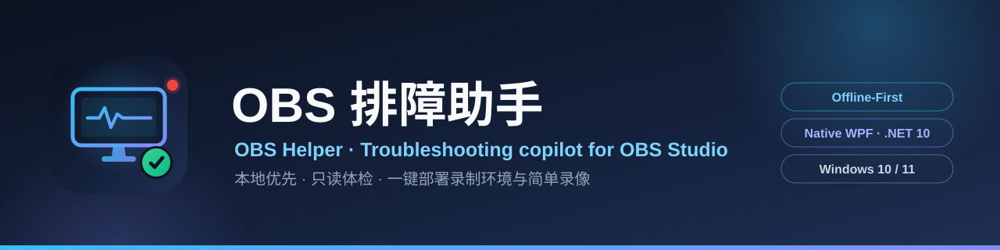
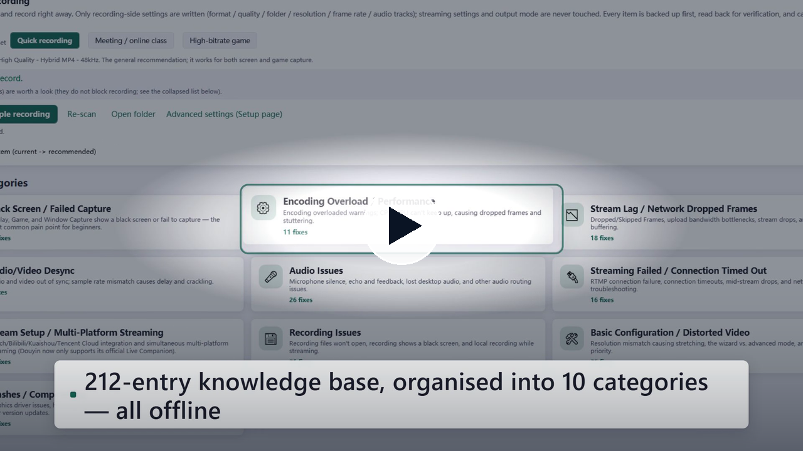

<div align="center">



**当前版本：V3.7.1** —— 手机当摄像头链路深化：Larix Grove 扫码、Larix 安装入口、WHIP 低延迟、回环推流鉴权与 key 撤销、WebRTC Origin 收口、浏览器 HTTPS 边界；1891 项单测、37 项无界面自检全部通过。详见 [`RELEASE_NOTES_v3.7.1.md`](RELEASE_NOTES_v3.7.1.md)。

> **V / X 双系列**：V 系列使用 `V3.7.1` 这类版本号；X 系列使用 `X1031` 这类日期码版本号。两者共用同一套功能与数据目录（X 系列仅额外使用专属图标），但更新检查只认各自系列的标签：V 构建只检测 `V*`，X 构建只检测 `X*`。

### 功能中心（V3.4.2 起）
左侧导航「功能中心」集中展示全部能力（手机与多设备、直播互动、智能与复盘、画质与分发、自动化与生态、开播与录制、虚拟直播与插件、诊断与工具箱、外观与系统），不再按版本号标注「本版新增 / 常用功能」——避免用户误以为只有这些是新功能，或误以为每个版本都必须塞进同样多的新功能。首页保留手机联动主推卡与「查看全部功能」。新功能必须登记模块并出现在功能中心，规则见 [`docs/FEATURE_MODULES.md`](docs/FEATURE_MODULES.md)。

### 设置与工具箱（V3.4.2）
- **设置** — 左栏按「基础设置 / 录制与自动化 / AI 与诊断 / 数据与存储 / 关于与帮助」分组，右侧一次只显示一个设置页，并给出该页的一句话指引；顶部搜索框可按标题、指引与关键词定位。
- **工具箱** — 18 个工具按「录制与文件 / 画面体检 / 音频体检 / 网络与推流 / 参数与隐私 / 冲突与版本 / 帮助与反馈」重排；分组筛选与分组目录同步，目录不再重复。

### 四模块页面自检（V3.4.0 收尾）
直播互动、智能与复盘、画质与分发、自动化与生态四页顶部都有「运行自检」：逐项列出正常 / 需配置 / 不可用，并给出下一步（连接 OBS、填写 WLED 地址、放置 FFmpeg/whisper 等）。自检只读，不改动任何设置；截图见 [`docs/reviews/v3.4.0/`](docs/reviews/v3.4.0/)。

> **本文档是 Windows 原生 WPF 版的开发向完整文档，随源码一起放在 `NOBS/`**；仓库根的 [`README.md`](../README.md) 是面向用户的完整说明（功能 · 使用 · 安装），本文档额外保留质量基线、逐版本发布说明与代码清单。
> **当前维护的源码在本目录的 [`OBS_Helper.Wpf/`](OBS_Helper.Wpf/)**；macOS 壳与旧版共享前端仅存档。

[](https://github.com/YYRMMAYO/OBS_Helper/actions/workflows/ci.yml)
[]()
[]()
[]()
[](https://github.com/YYRMMAYO/OBS_Helper/releases)
[](https://github.com/obsproject/obs-studio/releases)
[]()
[]()
[]()
[](../LICENSE)

[English](README.en.md) · **简体中文**

</div>

> **默认分支 `master` 是正式版（稳定通道）**：功能收敛、经过完整回归与发布验证，适合日常直播 / 录制。
> **V3.3.0 起只有 V 系列与 X 系列两个发布通道**：V 系列使用 `V主.次.修`，X 系列使用 `X` + `MMdd` 日期码；仓库没有 DEV 测试版分支或测试标签，全部文档只维护 `master` 一份。

**OBS帮助助手**（V2.9.6 前的名字是「OBS 排障助手」，同一个软件、同一条升级链路）是面向直播新手的 OBS Studio 排障工具：**纯离线可用**——208 条问题的知识库、排障指引、日志分析规则全部内嵌在程序里，不联网也能查；连上 OBS 之后还能远程控制场景、录制与推流，并做一键体检。

这是原 Blazor WebAssembly + WebView2 版本的**原生 WPF 重构**（源码就在本目录的 [`OBS_Helper.Wpf/`](OBS_Helper.Wpf/)），功能一比一对齐，但去掉了浏览器内核这一层：冷启动直接起窗口、自包含单目录发布、无需安装 WebView2 与 .NET 运行时。**V2.9.2 起支持中文 / English 即时切换**，**V2.9.3 起连随包离线内容也是中英双份**（知识库 208 条 / 插件目录 57 条 / 场景模板 12 套 / 排障指引全部英译，切语言即时生效）；**V2.2 起内置插件广场**（57 个精选插件 + 本机只读体检，v1.4 目录已全量复核）；**V2.1 起支持增量更新与知识库独立更新**。

> **兼容性**：主构建面向 **Windows 10 / 11**（.NET 10）；另有一套 **Windows 7 SP1 兼容构建**（.NET 6，最后一个支持 Win7 的 .NET 版本），安装包与便携包都在 Release 里，按系统选一个即可。
>
> **OBS 版本适配**：当前对齐 **OBS Studio 32.2.2**（最新稳定版）——日志解析、配置键、obs-websocket 协议与本机插件扫描（含 32.x 新增的「一插件一目录」插件根）均已按真实 32.2.2 环境核对，详见 [V2.9.3 发布说明](https://github.com/YYRMMAYO/OBS_Helper/releases/tag/V2.9.3)。

---

**目录**：[版本通道](#版本通道v-系列与-x-系列) · [宣传视频](#宣传视频) · [版本历史](#版本历史) · [亮点](#亮点) · [功能](#功能) · [智能诊断](#智能诊断) · [隐私与安全](#隐私与安全) · [安装与更新](#安装与更新) · [构建](#构建) · [工程结构](#工程结构) · [质量基线](#质量基线) · [已知边界](#已知边界) · [文档](#文档) · [捐赠支持](#捐赠支持) · [许可](#许可)

---

## 版本通道：V 系列与 X 系列

| 通道 | 版本号样式 | 定位 | 更新来源 |
| --- | --- | --- | --- |
| **V 系列**（`master`） | `V3.7.1` | **稳定优先**：功能收敛、经过完整回归与发布验证，适合日常直播 / 录制 | 正式 Release 页 · 蓝奏云 · 应用内增量更新 |
| **X 系列**（`master`） | `X1031` / `X1031Y2` / `X1031Y3` | **独立大版本**：`X` + `MMdd` 日期码，包含 X 专属图标；更新检查只看 `X` 标签 | X 系列 Release 页 · 应用内更新 |

- **两个系列共用功能与数据目录**：安装目录、程序集名、`%LocalAppData%\OBS_Helper` 都不变，升级链路一致。
- **通道过滤在解析层完成**：V 构建只认 `V3.7.1` 这类 V tag，X 构建只认 `X1031` 这类 X tag；两类 tag 挂在同一个仓库里，也不会互相被当成新版本。
- **X 版本号规则**：`X` 后面的四位是日期 `MMdd`（`X1031` = 10 月 31 日）。同一天再次发版追加 `Y1`、`Y2`、`Y3`…；更新检测先比日期，日期相同再比 Y 序号，所以 `X1031Y2 > X1031`、`X1101 > X1031Y99`。
- **X 更新提示**：检测到新版本后，更新弹窗会从 GitHub Release 拉取本版更新说明并展示；拉取失败不影响检查与下载。
- **X1031 范围小于 V3.5.0**：X1031 含需求 1–9 与新图标，但不含全局背景 UI 重构、手机连接页重排与功能中心体验优化；V3.5.0 含这些 UI 内容，但按需求继续使用原应用图标。

## 宣传视频

55 秒看懂 OBS帮助助手能帮你做什么 —— 中英两支都带背景音乐。点封面即看高清成片：

<div align="center">

[](https://github.com/YYRMMAYO/OBS_Helper/releases/download/V2.9.6/nobs-promo-zh.mp4)

▲ **宣传视频 · 中文版**（含背景音乐）：录前自检 · 日志离线分析与掉帧三分类 · 一键部署录制环境 · 插件广场本机体检 · 全局热键与实时监控 —— [观看 / 下载高清版](https://github.com/YYRMMAYO/OBS_Helper/releases/download/V2.9.6/nobs-promo-zh.mp4)（1920×1080 · 30fps · 55s）

<br/><br/>

[](https://github.com/YYRMMAYO/OBS_Helper/releases/download/V2.9.6/nobs-promo-en.mp4)

▲ **Promo video · English**（含背景音乐 / with BGM）：同一支片子的英文版，界面与字幕全英文 —— [Watch / download HD](https://github.com/YYRMMAYO/OBS_Helper/releases/download/V2.9.6/nobs-promo-en.mp4)（1920×1080 · 30fps · 55s）

</div>

---

## 版本历史

| 版本 | 重点 | 发布说明 |
| --- | --- | --- |
| **V3.7.1** | 手机当摄像头链路深化：Larix Grove 扫码、Larix 安装入口、WHIP 低延迟、回环推流鉴权与 key 撤销、WebRTC Origin 收口、浏览器 HTTPS 边界 | [`RELEASE_NOTES_v3.7.1.md`](RELEASE_NOTES_v3.7.1.md) |
| **V3.7.0** | 计时器补全、控制台/日志查找、托盘/热键/安全模式、插件查询退避 | [`RELEASE_NOTES_v3.7.0.md`](RELEASE_NOTES_v3.7.0.md) |
| **V3.6.0** | 导播计时器、音频电平表、脱敏诊断包、外链白名单、ColorCheck 路径护栏 | [`RELEASE_NOTES_v3.6.0.md`](RELEASE_NOTES_v3.6.0.md) |
| **V3.5.3** | 同步 X1031Y2 / X1031Y3 全部功能（X 专属图标除外） | [`RELEASE_NOTES_v3.5.3.md`](RELEASE_NOTES_v3.5.3.md) |
| **V3.4.2 / V3.4.1 / V3.4.0** | 手机联动、四模块自检、设置分类与工具箱分组、壁纸与提词器补强 | [`RELEASE_NOTES_v3.4.0.md`](RELEASE_NOTES_v3.4.0.md) |
| **V3.3.0** | 虚拟直播工作台、插件一键安装与 GitHub 搜索、无障碍 / 老年模式 | [`RELEASE_NOTES_v3.3.0.md`](RELEASE_NOTES_v3.3.0.md) |
| **V3.1.1 / V3.1.0** | 提词器手动移动、壁纸库、一键启动 OBS 并开录 | [`RELEASE_NOTES_v3.1.1.md`](RELEASE_NOTES_v3.1.1.md) |
| **V3.0.0** | 数据安全事务写入、无障碍、Win7 兼容构建、我的模板 / 知识库 | [`RELEASE_NOTES_v3.0.0.md`](RELEASE_NOTES_v3.0.0.md) |
| **V2.9.x** | 双语切换、随包内容英译、简单录像、反馈页、更名与图标统一 | [`RELEASE_NOTES_v2.9.6.md`](RELEASE_NOTES_v2.9.6.md) |

> 各版完整细节与「未交付 / 已知边界」见对应 `RELEASE_NOTES_*.md`；本表只保留大纲。

## 亮点

| | |
|---|---|
| **中文 / English 双语，可即时切换** | 界面、托盘、通知、报错提示、日志规则与体检结论全部双语，**默认中文**，在「设置 → 语言」里一点即换、不用重启；安装时会先问一次语言，作为首次启动的默认值。**V2.9.3 起随包离线内容（知识库 / 模板 / 插件目录 / 排障指引）也是中英双份**，切语言即时生效 |
| **208 条问题库，完全离线** | 内置 **208 条问题**（知识库 v2.3，首页按 14 个分类组织），含现象 / 成因 / 分步解决 / 小贴士 / 相关问题；步骤可勾选，进度自动记住。**知识库支持独立更新**（应用之外随拉随新，不用等发版），中英各一条通道 |
| **插件广场 + 本机体检** | 收录 **57 个精选插件**（8 大分类，v1.4 目录已全量复核：仓库是否归档 / 最近提交与发行 / 有无 Windows 成品包），卡片上标注**维护状态**并直达 GitHub Releases 下载；**只读扫描本机已装插件**——全盘定位 OBS 安装目录（注册表多视图 / 全盘驱动器布局 / Steam 多库）并覆盖 OBS 32.x 的「一插件一目录」插件根，装在非 C 盘也不漏扫；日志分析发现可疑模块可一键跳转对应插件；已知风险插件自动黄标提示 |
| **增量更新，更新更轻** | V2.1 起应用内「增量更新」只下载变更文件（相邻版本增量包通常只有几 MB）；逐文件 SHA-256 校验，失败自动回退完整安装包；安装版自动提权替换并重启 |
| **安装包自动清理** | 启动后自动扫描临时 / 下载 / 桌面目录，删除本应用旧安装包与增量包（每类保留最新一份），只认 `OBS_Helper_*` 命名，不碰其它文件 |
| **免费 AI 诊断，开箱即用** | 不用注册、不用 API Key。内置两条免费通道（智谱国内直连 / Pollinations 全球免 Key），**本地强制限频**保护免费服务，失败自动回退离线引擎 |
| **远程控制 OBS** | 场景切换、元素显隐、音频静音与音量、录制 / 推流 / 虚拟摄像头、定时停止、打开录制目录——控制台、托盘、全局热键、迷你小窗四种入口随时可用 |
| **全局热键** | `Ctrl+Alt+R` 录制 · `Ctrl+Alt+S` 推流 · `Ctrl+Alt+C` 虚拟摄像头 · `Ctrl+Alt+V` 存回放 · `Ctrl+Alt+K` 录制打点 · `Ctrl+Alt+M` 小窗 · `Ctrl+Alt+O` 显隐窗口 · `Ctrl+Alt+T/P/L` 提词器——全部可在设置里改键或停用 |
| **深度日志分析** | 离线解析 OBS 日志：**34 条规则 + 5 条派生判定 + 3 项量化比值（共 42 条线索）**（已按 OBS 32.2.2 真实日志核对解析）；日志在分析前**先脱敏**；掉帧 / 崩溃线索可关联到嫌疑插件并直达插件广场 |
| **场景模板一键落地** | 12 套内置直播间模板（游戏直播 / 竖屏口播带货 / 双人连麦 / 教学录屏 / 电台待机 / 开播·BRB·下播三件套 / 绿幕虚拟背景 / 带货双机位 / 电竞赛事解说 / 播客对谈 / 竖屏短视频录制 / 会议课程多机位），连上 OBS 一键生成场景与来源（含过渡设置）；模板会标注推荐插件并对照本机体检提示缺失 |
| **隐私优先** | 偏好文件不含任何凭据；密码与 API Key **双层加密**（AES-256-GCM + DPAPI）。只有你主动发起诊断才会联网，请求前先脱敏；本机插件体检全程只读、结果仅存本机 |
| **一键部署录制环境** | 装好 OBS 后一条龙：逐项列出「录制向」推荐值（录像格式 / 质量 / 目录 / 画布分辨率 / 帧率 / 采样率）与当前值对照，勾选后**先自动备份**再落地，可一键回滚；连上 OBS 走 obs-websocket 即时生效，OBS 已退出则改 `basic.ini`（写盘后读回校验） |
| **简单录像（一键开录）** | 首页一张卡：「快速录像 / 会议网课 / 游戏高码率」三档预设选一个，点一次就完成自检 → 备份 → 落地 → （OBS 没开就拉起并等就绪）→ 开始录制；录制中显示已录时长与剩余可录，停止后提示文件并可一键打开目录 / 转 MP4 |
| **零第三方依赖** | 原生 WPF + .NET 10（另有一套 .NET 6 的 Win7 兼容构建），无 NuGet 包、无 WebView2，`obs-websocket` 协议纯手写；文案表也是纯 BCL 的 C# 字典（零依赖双语）；自包含单目录，秒开 |

## 功能

### 学习与排查

- **新手教程** — 首次启动的四步分步引导（连上 OBS → 出问题先查这里 → 一键体检 → 开播与装修），讲到的入口都是真实导航名；`设置 → 新手引导` 可随时重看，无需重启
- **知识库** — 208 条问题（知识库 v2.3，首页按 14 个分类组织），含现象 / 成因 / 分步解决 / 小贴士 / 相关问题；步骤可勾选且进度会记住
- **知识库独立更新** — 问题库 / 插件目录与应用版本解耦：启动静默自动更新（6 小时节流）/ 设置页「检查知识库更新」/ 更新弹窗「仅更新知识库」三入口；GitHub raw 主通道 + Release 资产兜底
- **搜索** — 边打边搜，跨标题、现象、成因匹配
- **问我一下** — 用大白话描述现象，自动匹配最可能的问题
- **排障指引** — 通用排查思路速查手册

### 插件广场

- **精选插件目录** — 8 大分类 × 57 个精选插件（自动化 / 视觉特效 / AI 智能 / 音频 / 多平台竖屏 / 录制后期 / 输入互动），目录外置热更新，链接纠错与新插件上架无需发版；**v1.4 目录已按「仓库未归档 + 近 12 个月有动静 + 有 Windows 成品包」全量复核**，卡片标注维护状态（放缓的会明示理由）
- **本机插件体检（只读）** — 扫描已装 DLL 与版本，标注「广场收录 / 未收录」；OBS 安装目录多信号全盘定位：进程 → 注册表（HKLM 双视图 + HKCU + DisplayIcon 反推）→ 全盘固定驱动器常见布局 → Steam 多库解析，兼容便携版、用户级插件目录与手动指定目录
- **直达下载** — 每张卡片直达 GitHub Releases 最新版，带「最新 vX.Y.Z」角标；可「关注」插件，启动时静默查新（仅 Toast）
- **日志 × 插件联动** — 日志分析提取加载失败 / 崩溃肇事模块，能对上广场条目时一键跳转；AI 类插件标注公开开销并联动系统监控给性能预算提示

### 智能诊断

- **智能诊断** — 连上 OBS 后一键体检；三种引擎可选（见下方 [智能诊断](#智能诊断)），**结果可导出为 Markdown 报告**
- **日志分析** — 离线解析 OBS 日志：34 条规则 + 5 条派生判定 + 3 项量化比值（共 42 条线索）；分析前先脱敏

### 控制 OBS

- **OBS 控制台** — 场景切换、元素显隐、音频静音与音量、录制 / 推流 / 虚拟摄像头、实时统计、**定时停止录制/推流**、**一键打开录制目录**
- **系统托盘 + 通知** — 关闭窗口最小化到托盘，托盘菜单直接控制录制 / 推流 / 虚拟摄像头；录制 / 推流状态变化弹系统通知（可关）
- **迷你小窗** — 置顶小窗一键开始 / 停止录制与推流（含虚拟摄像头），可拖拽、记住位置；托盘菜单、控制台页按钮或全局热键随时呼出
- **全局热键** — 系统级快捷键（默认 `Ctrl+Alt+R/S/C/V/K/M/O` 与提词器 `Ctrl+Alt+T/P/L`），全部可在设置页改键或停用
- **场景自动切换** — 按前台窗口标题自动切换场景，支持关键词 / 正则规则，规则表在设置页管理

### 保持健康 & 快速开播

- **系统监控** — CPU / 内存 / 网络上下行 / 磁盘空间实时曲线（近 2 分钟），与 OBS 渲染帧率、丢帧数据联动，磁盘空间不足时预警
- **场景模板** — 12 套内置直播间模板，连上 OBS 一键落地场景与来源（自动设置过渡与时长）；未连接时可导出为标准场景集合 JSON
- **OBS 配置管理** — 配置目录检测、备份 / 导出（ZIP，默认脱敏不含推流密钥）、导入（覆盖 / 合并，自动预备份）、轻度重置与彻底重置
- **直播搭建** — 从零到开播的 6 步流程 + B站 / 抖音 / 快手 / 视频号 / 小红书 / YouTube / Twitch 等主流平台的推流配置
- **外观** — 浅色 / 深色 / 跟随系统，4 档字号，高对比与减少动画
- **语言** — 简体中文 / English 即时切换（默认中文，无需重启）；安装向导里选定的语言是首次启动的默认值。**界面与随包内容（知识库 / 模板 / 插件目录 / 指引）同步跟随**
- **一键部署录制环境** — 搭建页的录制环境卡：逐项列出推荐值与当前值，勾选后先备份再落地，可一键回滚
- **简单录像** — 首页的简单录像卡：三档预设一键配好并开录，OBS 没启动时会先拉起并等就绪；录制中显示已录时长与剩余可录；停止后可打开目录或一键转 MP4
- **获取 OBS** — 官方三条入口 + 应用内下载官方安装包（带进度、可启动安装向导）+ 瓦特工具箱 / 微软商店两条备选通道
- **帮助与反馈** — 一级导航直达：表单二维码随包离线可扫、GitHub Issue 入口，**安全上报引导**（邮件 / 仓库 Security 私密通道），以及**一键复制报错材料**（版本与检测结论，不含路径与日志原文）

### 界面与设置（V3.4.2）

- **设置分类导航** — 左栏按「基础设置 / 录制与自动化 / AI 与诊断 / 数据与存储 / 关于与帮助」分组，右侧一次只显示一个设置页；顶部搜索框按标题、指引与关键词定位。每页都有一句话说明「这里管什么」，不再是把十几张卡片一路铺到底
- **工具栏分组** — 工具箱按「录制与文件 / 画面体检 / 音频体检 / 网络与推流 / 参数与隐私 / 冲突与版本 / 帮助与反馈」重排，分组筛选与分组目录同步，所有检查仍然只读
- **功能中心** — 不再标注「V3.4.x 新功能 / 本版新增」，统一按能力域展示；版本号只出现在「关于」里，不再暗示「新版本必须新增多少功能」

## 智能诊断

连上 OBS 后一键体检，三种引擎可选：

| 引擎 | 原理 | 成本 |
| --- | --- | --- |
| **本地规则引擎**（默认） | 确定性离线规则匹配，与日志分析同源 | 免费、纯离线 |
| **免费 AI（内置）** | 两条通道——**智谱免费模型**（国内直连最稳，密钥构建时加密内嵌）与 **Pollinations**（国外免 Key 公共通道）。本地限频：智谱 **10 次/天**、Pollinations **20 次/天**，独立计数、互不挤占，每天 0 点恢复 | 免费、免注册 |
| **云端大模型** | OpenAI 兼容接口 + function calling，接入你自己的 API Key（双层加密保存在本机） | 你的 API 费用 |

云端 / 免费失败时**自动回退本地引擎**，并在结果中说明原因。免费档为单轮普通对话（不做知识库工具调用）；需要多轮深度排查或更高频使用，请接入你自己的云端 API。

## 隐私与安全

所有数据只存在本机：

- **偏好**（外观、语言、收藏、步骤进度、连接设置、热键键位、自动切换规则、托盘行为）→ `%LocalAppData%\OBS_Helper\prefs.json`——明文 JSON，**均不含任何凭据**
- **OBS 密码与 AI API Key** → `%LocalAppData%\OBS_Helper\secrets.dat`——**双层加密**：值先经 AES-256-GCM（密钥由本机 `MachineGuid` 经 PBKDF2-SHA256 派生）加密，整个文件再经 DPAPI（绑定当前 Windows 用户 + 应用熵）加密；换机 / 换用户无法解开，即使文件被离线窃取也无法还原

**发现了安全漏洞？** 请勿在公开 Issue 里披露细节 —— 走仓库 **Security → Report a vulnerability** 私密通道，或发邮件到 **752139192@qq.com**（标题加 `[SECURITY]`）。完整策略见 [SECURITY.md](../SECURITY.md)（中英双语）。中文或英文都可以。

只有在你**主动开启**「免费 AI」或「云端诊断引擎」并发起诊断时才会联网，且请求前会先对日志脱敏。OBS 配置备份 / 导出默认不含推流密钥（可勾选包含），密码与 Token 自动脱敏。

## 安装与更新

- **GitHub Releases** — 从 [Releases 页面](https://github.com/YYRMMAYO/OBS_Helper/releases) 下载安装包或便携版；便携版免安装、自带 .NET 运行时。**安装向导会先让你选语言**（简体中文 / English），默认中文，选定结果作为应用首次启动的默认语言
  - `OBS_Helper_Setup_3.1.1.exe` / `OBS_Helper_Portable_3.1.1.zip` — **主构建**，面向 **Windows 10 / 11**
  - `OBS_Helper_Setup_3.1.1_win7.exe` / `OBS_Helper_Portable_3.1.1_win7.zip` — **Win7 兼容构建**，面向 **Windows 7 SP1 及以上**（.NET 6，已停止安全更新；新机器请用主构建）
  - 两个构建共用同一个 AppId，从兼容构建换到主构建会被识别成升级而不是装两份
- **蓝奏云（国内镜像）** — 提取码 `YYKWY`（详见应用内更新弹窗）
- **应用内更新（推荐）** — 「检查更新」对比 GitHub 最新版本后，可任选：
  - **增量更新全部功能**：只下载自上一版本以来的变更文件（通常几 MB），下载后自动校验、提权替换并重启
  - **仅更新知识库**：单独升级问题库，几秒完成，不用重装应用
  - **完整安装包**：蓝奏云 / 应用内下载整包覆盖安装

> **主构建**支持 Windows 10 / 11；**兼容构建**支持 Windows 7 SP1 及以上。均无需 WebView2、无需另装 .NET 运行时。
> 已装 3.1.0 的用户可直接走应用内「增量更新」升到 3.1.1（增量包以 3.1.0 为基准）；本版只加功能，`AppId` / 安装目录 / 数据目录
> 都没变，所以增量升级与覆盖安装都照旧。**3.0.0 及更早的用户**增量包基准对不上，
> 请用安装包或便携包覆盖升级。
> **语言与升级**：安装时选的语言只决定首次启动的默认值；之后在应用内改过语言，重装 / 升级都不会覆盖你的选择。
> 还没装 OBS？应用内「搭建」页 / 「工具箱」/ 首页欢迎卡都提供**官方**下载入口
> （`obsproject.com` 与 GitHub 官方发布页），也可以直接在应用内下载官方安装包；
> GitHub 拉不动时可先用瓦特工具箱（原 Steam++）加速，或改用微软商店的 OBS。
> 遇到问题？左侧导航的 **「帮助与反馈」** 页有反馈表单（手机扫码即可填）、GitHub Issue 入口、
> 安全上报引导，以及「一键复制报错材料」；首页快捷入口与托盘菜单也各有一个入口。
> **安全问题请勿公开披露** —— 走仓库 **Security → Report a vulnerability**，或邮件 **752139192@qq.com**。

## 构建

需要 [.NET 10 SDK](https://dotnet.microsoft.com/download)（构建 Win7 兼容目标时会自动拉取 .NET 6 的参考包）；
打安装包还需要 [Inno Setup 6](https://jrsoftware.org/isdl.php)。

```powershell
# 在仓库根目录（`NOBS/` 的上一级）
cd NOBS

# 跑起来看看
dotnet run --project OBS_Helper.Wpf

# 双目标：主构建 + Win7 兼容构建 -> 安装包 / 便携 zip / 增量包 / 知识库资产
.\build.ps1

# 只出主构建（快速迭代时）
.\build.ps1 -SkipLegacy

# 额外出一个单文件 exe（主构建）
.\build.ps1 -SingleFile

# 没装 Inno Setup 时只出便携包
.\build.ps1 -SkipInstaller

# 跳版本发布：指定增量包基准（让停留在更早版本的用户也能直接增量升级）
.\build.ps1 -DeltaBaseVersion 2.0.0

# 发布后校验增量包可完整升级（模拟升级 + 全文件 SHA-256 比对）
python scripts\verify_delta.py --old PAKE\windows\OBS_Helper_Portable_3.0.0.zip --delta PAKE\windows\OBS_Helper_Update_3.1.1.zip --publish OBS_Helper.Wpf\bin\Release\net10.0-windows\win-x64\publish

# 全量单测（含中英内容对等 / 资产按语言装载 / INI 打补丁 / 版本判据等）
dotnet test OBS_Helper.Wpf.Tests\OBS_Helper.Wpf.Tests.csproj -c Release
```

产物落在 `NOBS\PAKE\windows\`（即本目录下的 `PAKE\windows\`）：

- `OBS_Helper_Setup_3.1.1.exe` — 安装包（主构建，MinVersion 10.0，向导含语言选择页）
- `OBS_Helper_Setup_3.1.1_win7.exe` — 安装包（Win7 兼容构建，MinVersion 6.1sp1）
- `OBS_Helper_Portable_3.1.1.zip` / `…_win7.zip` — 解压即用
- `OBS_Helper_Update_3.1.1.zip` — 增量更新包（含 `update_manifest.json`，应用内增量更新用）
- `OBS_Helper_Portable_3.1.1.exe` — 单文件（需 `-SingleFile`）
- `OBS_Helper_Knowledge_3.1.1.json` / `…3.1.1.en-US.json` — 问题库热更新资产（中英各一份）
- `OBS_Helper_Plugins_3.1.1.json` / `…3.1.1.en-US.json` — 插件广场目录热更新资产（中英各一份）
- `manifests/manifest_<ver>.json` — 各版本完整文件清单（SHA-256，增量包 diff 基准；不随 Release 发布）

## 工程结构

```
NOBS/
  OBS_Helper.Wpf/
    App.xaml(.cs)          应用入口、全局异常 -> 报错码弹窗
    MainWindow.xaml(.cs)   左侧导航 + 顶栏 + 页面容器 + 新手引导覆盖层，路由注册在这里
    AppServices.cs         组合根：所有服务的惰性单例，手工装配
    Navigation/            极简路由（路由名 -> 页面工厂，带缓存与后退栈）
    Localization/          文案表（中 / 英两份，纯 BCL 零 WPF 依赖）
                           + DataValues（跨语言展示值判定）
                           + ContentAssets（随包内容按语言装载 + 回退标记）
    Compat/                Windows 7 兼容构建（net6.0-windows）所需的编译期 polyfill
    Views/                 20 个页面 / 窗口（17 个页面 + 3 个窗口）
    Controls/              共享控件与值转换器（含下载卡 / 反馈卡 / 一键部署录制环境卡）
    Themes/                Palette.xaml 调色板 + Controls.xaml 样式库
    Models/                知识库、obs-websocket 协议、OBS 配置模型
    Services/
      Compat/              FolderPicker（net6/net8 两条分支）等跨 TFM 等价实现
      Host/                HostBridge（DPAPI、日志读取、AI 转发）、LocalStore
      Obs/                 WebSocket 客户端、连接服务、日志分析、脱敏
      ObsConfig/           OBS 配置定位、备份/导出/导入、重置、场景模板落地、
                           RecordingEnvCore/Service（一键部署录制环境：推荐项 + INI 打补丁）
      Plugins/             插件广场：目录数据 / 本机体检扫描（含 OBS 32.x 插件根）/ Releases 查新 / 关注提醒
      Update/              增量更新、知识库独立更新（按语言分发）、安装包自动清理、
                           ObsDownloadLinks / FeedbackLinks（出站白名单常量）
      Ai/                  本地 / 免费 / 云端诊断引擎与编排（含免费档本地限频器）
      Shell/               系统托盘、全局热键、场景自动切换、定时器、系统监控、录制守护、日志尾随、新手引导
      Markdown/            排障指引的 Markdown 解析
      OsSupport.cs         Windows 版本判据（决定商店入口等能力的显隐）
      LocalizationService.cs  语言服务：偏好持久化、写入 Application.Resources、广播语言切换
    Assets/                problems[.en-US].json / plugins[.en-US].json / scene_templates[.en-US].json /
                           troubleshooting[.en-US].md（中英并列，内嵌种子）、feedback_qr.png、图标
  OBS_Helper.Wpf/OBS_Helper_Setup.iss  Inno Setup 脚本（按 TFM 传 MinVersion / 输出名，UTF-8 带 BOM）
  OBS_Helper.Wpf.Tests/    1697 项单测（直接链接纯逻辑源文件，不引用整个 WPF 工程）
  build.ps1                Windows 构建与打包脚本（双目标：安装包 / 便携 / 增量包 / 清单 / 内容资产）
  scripts/verify_delta.py  增量包发布校验工具（模拟升级 + 全文件 SHA-256 比对）
```

换肤与换语言走的是同一条路：**把当前主题的调色板 / 当前语言的文案整体写进 `Application.Resources`**，
XAML 一律用 `DynamicResource`（主题键直接用、文案键写作 `Loc.<键>`）引用，
所以两者都是整窗即时生效的，不需要重建窗口或重启。
代码里拼出来的文案由 `LocalizationService` 广播事件、主窗口把当前页面原地重放一次刷新。

### 仓库结构

| 目录 | 说明 |
| --- | --- |
| `NOBS/` | **当前维护中的 Windows 原生 WPF 版**（本文档介绍的就是它） |
| `OBS_Helper.Client/` | 旧版共享前端（Blazor WASM），仅存档 |
| `OBS_Helper.Mac/` | macOS 桌面壳（Tauri v2），仅存档 |

## 功能底座（V2.2 ~ V2.9.2 保持不变）

- 体检工具箱：色彩 / 采样率 / 黑屏专项 / 音频深度 / 虚拟摄像头 / 磁盘写入 /
  编码顾问 / 节点探测八卡齐全；
- 日志分析三大分诊：掉帧三分类主因判定、编码过载按当前设置分诊、双显卡错位检测；
- 插件广场 57 条目（v1.4 目录）外置热更新、本机插件只读体检、日志 × 插件嫌疑联动；
- 知识库 208 条（知识库 v2.3，首页按 14 个分类组织）、增量更新、知识库独立更新、安装包自动清理；
- 后台守护：录制守护、实时日志尾随预警、场景自动切换、全局热键、迷你小窗、系统托盘。

## 质量基线

- **1891 项单元测试全部通过**（V3.7.1 发布时；文案表截至 V3.7.1 为 3644 条；V3.7.0 时为 1870 项，V3.6.0 时为 1869 项，V3.5.3 时为 1809 项，V3.4.2 时为 1729 项，V3.4.1 时为 1687 项，V3.4.0 时为 1670 项，V3.0.0 时为 1209 项。覆盖壁纸校验 / 迁移 / 轮播、
  连接错误分类与重试策略、首次同意与倒计时归一化、提词器数值与场景匹配、命名模板净化与冲突、
  静音提醒阈值与防重复）；Headless 自检 37 项全部 PASS，
  且**主构建与 Win7 兼容构建各跑一次**（29 条路由用例 + 8 项非路由检查：新手引导覆盖层（含逐步跳转校验）、迷你小窗
  + 文案资源解析 + 语言切换往返 + 逐页语言重放 + 内容回退提示条 + D7 连接态护栏 + 双构建协议分支）；
- V3.0.0 新增的测试盯的是本轮最容易「静默失效」的地方：v5 与 v4 的请求名（用官方协议表守卫，
  写错即红）、变换字段形状（v5 扁平裁剪 vs v4 嵌套裁剪，两边各有断言）、深拷贝字段保全、
  本地条目的 null 集合与逐元素容错、回退提示的登记与撤销、无障碍三条静态规则；
- V2.9.6 那一版新增的单测只干一件事：把「改名 + 换图标」这类**编译器看不见、只在用户装上之后
  才暴露**的漏改钉死 —— 产品名在 csproj / 安装包脚本 / 文案表**三处一致**、文案表不再出现旧名、
  版本号在 csproj 与 `.iss` 之间一致、`appicon.ico` 含 Windows Shell 会取的 7 档尺寸
  且 csproj 里三处引用齐全；
- 沿用前几版积累的错法清单（这些仍在守着）：中英内容形状逐条对等、英文侧无残留汉字与全角标点、
  展示值落在 `DataValues` 认识的取值内、场景来源名一致且不撞名、指引标题层级 / 代码围栏 /
  链接 URL 与中文版一一对应、资产按语言的解析与回退次序、Release 资产匹配不串语言、
  INI 打补丁的保真性与读回校验、Windows 版本判据每一档、下载与反馈入口白名单、
  `AesGcm` 兼容实现与原构造函数的密文对拍；
- 三轮分视角审校（V2.9.3：数据安全与出站 / 双目标与构建边界 / 交互与文案一致性），
  **如实标注了哪些结论有机器证据、哪些只是人工核对** →
  [`docs/reviews/REVIEW_2026-10-05-v2.9.3.md`](docs/reviews/REVIEW_2026-10-05-v2.9.3.md)；
- 全程零第三方 NuGet 包（纯 BCL）。

## 已知边界

- Windows 7 **真机未验证**：兼容构建的本机自检（.NET 6 桌面运行时）29 项全过、安装包 MinVersion 也正确下发，
  但**没有在真实 Windows 7 机器上装过、跑过**；旧协议（obs-websocket 4.x）握手**未对真实 OBS 27 验证过**；
- 英译**未对着英文版 OBS 逐条核对菜单路径的逐字一致性**，也未经母语者校订
  （技术准确、术语统一，但不等于出版级地道）；
- 一键部署的两条通道按协议 / 键名实现并有单测，但**没有对真实 OBS 跑过一次端到端落地**；
- 无障碍只做到「代码级适配 + 静态检查」，**未经 NVDA / Narrator 实测**（详见 `../ACCESSIBILITY.md`）；
- 发布产物**未做代码签名**（本机无 Authenticode 证书），Windows SmartScreen 可能提示未知发布者；
- 兼容构建使用的 .NET 6 已停止安全更新，它是「必须跑 Win7」时的退路，新机器请用主构建。

## 文档

- 仓库首页（面向用户的完整说明）→ [`../README.md`](../README.md)
- **分支与文档分工规则（所有文档只维护 master）→ [`../docs/BRANCH_AND_DOC_RULES.md`](../docs/BRANCH_AND_DOC_RULES.md)**
- **发版内容规则（每个 Release 必须写清新增 / 修复）→ [`../docs/RELEASE_RULES.md`](../docs/RELEASE_RULES.md)**
- English（完整文档）→ [`README.en.md`](README.en.md)
- English → [`../README.en.md`](../README.en.md)
- 本版发布说明（V3.1.1，含新功能、行为变更与未交付项）→ [`RELEASE_NOTES_v3.1.1.md`](RELEASE_NOTES_v3.1.1.md)
- 上一版发布说明（V3.1.0）→ [`RELEASE_NOTES_v3.1.0.md`](RELEASE_NOTES_v3.1.0.md)
- 上一版发布说明（V3.0.0）→ [`RELEASE_NOTES_v3.0.0.md`](RELEASE_NOTES_v3.0.0.md)
- 三轮审校记录（V2.9.3，含证据边界） → [`docs/reviews/REVIEW_2026-10-05-v2.9.3.md`](docs/reviews/REVIEW_2026-10-05-v2.9.3.md)
- 英文内容落地方案（V2.9.3 的作业规范）→ [`docs/I18N_EN_CONTENT_PLAN.md`](docs/I18N_EN_CONTENT_PLAN.md)
- 插件广场复核报告（v1.4）→ [`docs/PLUGIN_AUDIT_2026-09.md`](docs/PLUGIN_AUDIT_2026-09.md)
- 无障碍承诺与已知限制（键盘 / 屏幕阅读器 / 高对比 / 字号档位）→ [`../ACCESSIBILITY.md`](../ACCESSIBILITY.md)
- 质量与审查报告索引（含各份记录的时效说明）→ [`docs/QA-REPORT.md`](docs/QA-REPORT.md)
- 项目库代码清单 → [`docs/CODEBASE.md`](docs/CODEBASE.md)
- 架构总览 → [`docs/ARCHITECTURE.md`](docs/ARCHITECTURE.md)
- 缺口开发指引（V2.8 依据，**2026-08 快照**，其中的数字已过期）→ [`docs/DEV_GUIDE_GAPS_2026-08.md`](docs/DEV_GUIDE_GAPS_2026-08.md)

## 捐赠支持

如果这个小工具帮你省下了排查时间，可以请作者喝杯咖啡 —— **完全自愿，金额随意**，不捐也照样免费使用全部功能。

<div align="center">

| 微信支付（推荐） | 支付宝（推荐） |
| :---: | :---: |
|  |  |
| 扫码 → 微信支付 | 扫码 → 支付宝 |

</div>

> **关于捐赠，有句话必须说清楚**：捐赠**不会换取任何优先级** —— 不插队、不加急、不影响 issue 的处理顺序，
> 也不附带功能解锁、定制开发或任何售后承诺。它**只是单纯的捐赠**，用来支持项目的持续开发
> （测试设备、签名证书、文档与时间投入）。软件本身始终免费、以 MIT 许可开源；
> 认真反馈问题、补充文档、提 PR 同样是很有价值的支持。

## 许可

MIT，见 [LICENSE](../LICENSE)。

### 开源组件与许可

本项目基于以下开源项目与公开协议开发，在此致谢（完整清单、许可证与边界见
[`docs/OPEN_SOURCE_ATTRIBUTION.md`](docs/OPEN_SOURCE_ATTRIBUTION.md)）：

| 项目 | 许可证 | 用途 | 边界 |
|---|---|---|---|
| [OBS Studio](https://github.com/obsproject/obs-studio) | GPL-2.0 | 被控制的目标软件 | 只做外部集成，不捆绑、不修改 |
| [obs-websocket](https://github.com/obsproject/obs-websocket) | GPL-2.0 | 场景 / 录制 / 推流 / 虚拟摄像头控制 | 按公开协议自行实现 C# 客户端，不复制代码 |
| [VTube Studio API](https://github.com/DenchiSoft/VTubeStudio) | MIT | Live2D 模型加载 / 鉴权 | 只使用公开 WebSocket API，不注入进程 |
| [.NET / WPF](https://github.com/dotnet/wpf) | MIT | 桌面运行时与 UI 框架 | 自包含发布，运行时随包携带 |
| [xUnit](https://github.com/xunit/xunit) | Apache-2.0 | 单元测试 | 仅测试工程，不进发布物 |
| [DistroAV](https://github.com/DistroAV/DistroAV) / [obs-spout2-plugin](https://github.com/Off-World-Live/obs-spout2-plugin) | GPL-2.0 | Live2D 的 NDI / Spout2 采集 | 只做外部可选插件引导，不复制、不捆绑 |
| [Watt Toolkit](https://github.com/BeyondDimension/SteamTools) | GPL-3.0 | GitHub 加速 | 只检测 / 启动 / 引导，不修改其配置 |

> Live2D Cubism SDK 为专有许可，本项目**不包含**、**不分发**任何 Cubism 运行时或示例模型；
> 用户自备的模型归用户所有。主程序仍以 **MIT** 许可发布。
